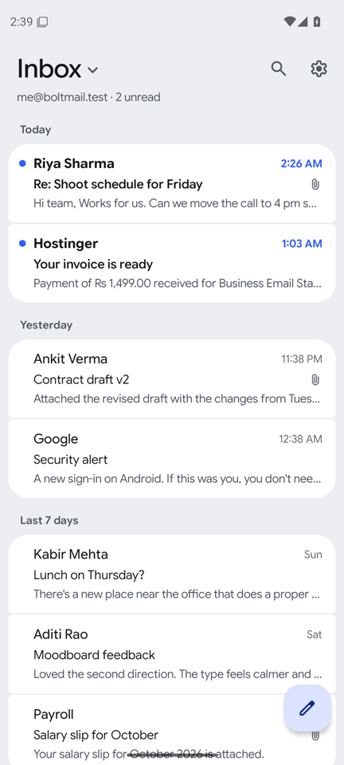
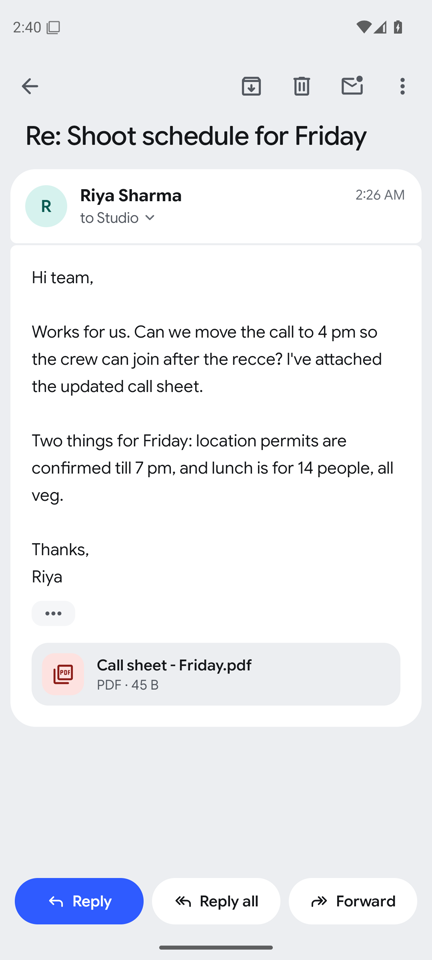
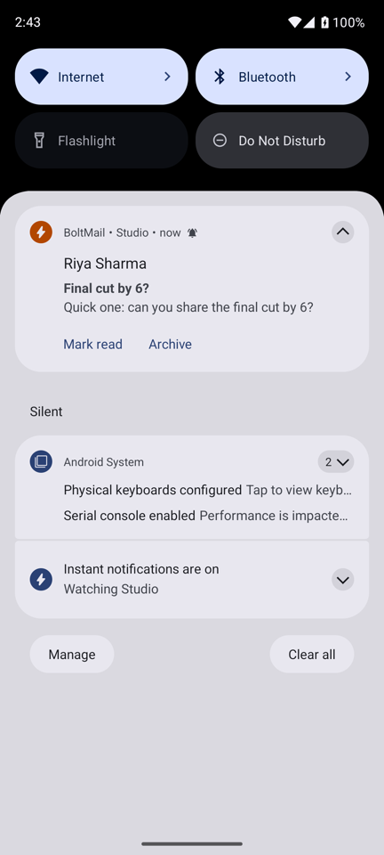
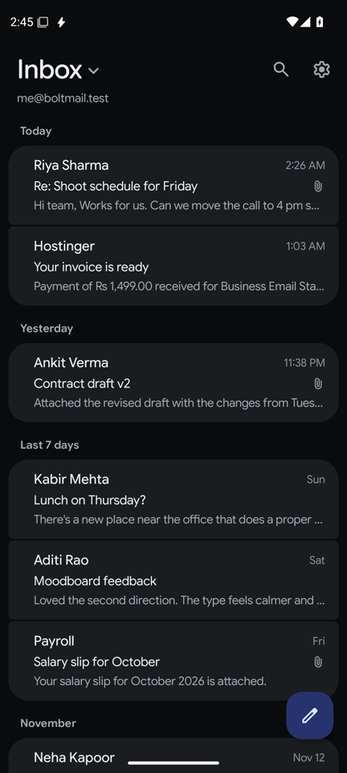

# BoltMail

A small, quiet Android mail app for IMAP accounts (Hostinger, Gmail, Zoho, Yahoo, iCloud, Fastmail, your own domain) with instant push notifications.

   

<sub>Screenshots from the emulator with made-up sample mail.</sub>

- **Instant notifications.** BoltMail keeps an IMAP IDLE connection open to each mail server, so a new email shows up on the phone a second or two after it arrives.
- **One inbox for every account**, grouped by day, with each account's folders a tap away.
- **Reading.** Plain-text and HTML mail. Remote images are blocked until you tap *Show*, because senders use them to track opens.
- **Writing.** Reply, reply all, forward and new mail, with attachments. Mail goes out through each account's own SMTP server, and a copy is filed in Sent.
- **Swipe** right to archive and left to delete, with undo.
- **Setup is an email address and a password.** BoltMail finds the server settings from a built-in provider list, the domain's MX records, the domain's autoconfig file or Thunderbird's provider database, and falls back to a manual form.
- **Light and private.** The release APK is about 1.8 MB. There are no analytics and no BoltMail servers. Passwords are encrypted with an Android Keystore key, and nothing is backed up off the phone.

## Install on your phone

Download the latest `BoltMail-x.y.z.apk` from [Releases](https://github.com/natyavidhan/boltmail/releases/latest) and open it on the phone, allowing your browser or file manager to install apps. BoltMail needs Android 8.0 or newer.

To build it yourself:

```sh
./gradlew :app:assembleRelease
# APK: app/build/outputs/apk/release/app-release.apk
adb install -r app/build/outputs/apk/release/app-release.apk   # or copy the file to the phone and open it
```

The release build is signed with this computer's debug key (`~/.android/debug.keystore`), so each new build installs over the previous one and keeps your data. Build updates on this machine, or copy that keystore to wherever you build.

## First run

1. **Add an account.** Enter the email address and password. For Hostinger, use the mailbox password you set in hPanel.
2. **Allow notifications and "Run in the background"** when BoltMail asks. On Xiaomi, OnePlus, Realme, Oppo and Vivo phones, also turn on *Autostart* for BoltMail in the phone's settings. These phones kill background apps aggressively, and that is the usual reason push arrives late.
3. **The "Instant notifications are on" notification** is what keeps the connection alive. To hide it, long-press it and turn off *Push connection*. Push keeps working.

Each account gets its own notification channel, so you can give each inbox its own sound in Android's settings.

## Gmail

There are two ways to add Gmail:

- **Sign in with Google.** This needs a one-time Google Cloud setup; see [GOOGLE_SIGN_IN.md](GOOGLE_SIGN_IN.md).
- **App password.** Turn on 2-Step Verification, create an app password at <https://myaccount.google.com/apppasswords>, then choose *Use an app password instead* when adding the account.

## Not supported

- **Proton Mail.** Proton has no IMAP access without Proton Bridge on a computer.
- **Outlook.com and Microsoft 365.** Microsoft only allows OAuth sign-in for other mail apps, and BoltMail can't do Microsoft sign-in yet.

## How push works

`PushService` is an always-on foreground service (type `specialUse`, which is fine for a sideloaded app). It runs one `IdleWorker` thread per account. Each worker:

1. connects, syncs the inbox, then sends IMAP `IDLE`;
2. wakes when the server reports new mail, fetches it, posts the notification and goes back to `IDLE`;
3. is pinged every 12 minutes by an exact, Doze-proof alarm. If the server doesn't answer within 25 seconds, the worker closes the dead socket and reconnects, because mobile networks silently drop idle connections;
4. reconnects immediately when the phone switches networks, and backs off on errors.

Actions you take (read, archive, delete, move, send) change the local database first, so the UI updates instantly, and are then queued in an outbox (`ops` table) that replays against the server, retrying with backoff when offline. Archive and delete wait six seconds before running so *Undo* can cancel them.

## Build and test

Requirements: JDK 17 and Android SDK platform 35.

```sh
./gradlew :app:assembleDebug        # debug APK
./gradlew :app:testDebugUnitTest    # MIME parsing, addressing, DNS, provider detection, quoting
```

For end-to-end testing without a real mailbox, [`tools/greenmail.py`](tools/greenmail.py) explains how to start a local [GreenMail](https://greenmail-mail-test.github.io/greenmail/) server, fill it with sample mail and send new messages to test push. From the emulator the server is reachable at `10.0.2.2`, with security set to *None*.

## Layout

```
app/src/main/java/dev/natya/boltmail/
  data/      Room entities and DAO, Keystore-encrypted secrets, preferences
  mail/      IMAP/SMTP sessions, sync, MIME parsing, provider discovery, outbox (OpRunner), composer
  push/      foreground push service, IDLE workers, keep-alive alarm, notifications
  ui/        Compose screens: inbox, message, compose, setup, settings; theme and shared components
```

The design system is documented in [DESIGN.md](DESIGN.md) and product decisions in [PRODUCT.md](PRODUCT.md). Bundled fonts and icons are listed in [THIRD_PARTY.md](THIRD_PARTY.md).

## Known gaps in 0.1

- No conversation threading; each message is its own row.
- No drafts. Leaving the compose screen asks whether to discard.
- Search covers mail already on the phone: the newest 50 per folder, plus anything older you scrolled to.
- Replies are plain text.
- Google sign-in is built but hasn't been tested end to end. That needs your Cloud project and a Google account on a real phone.
